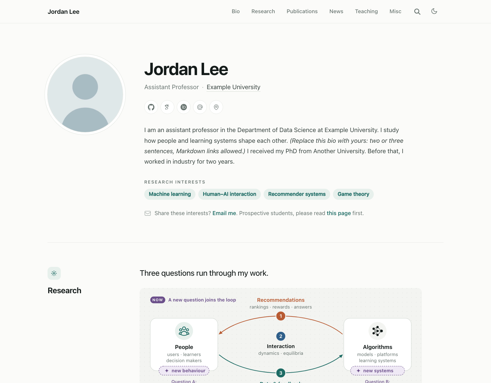
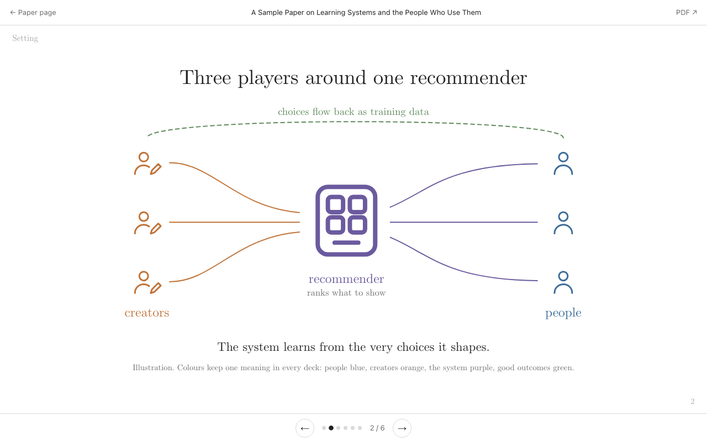

# Academic Homepage Template

A clean, fast personal website for researchers, built with [Hugo](https://gohugo.io/) on the
[HugoBlox](https://github.com/HugoBlox/kit) theme. It gives you a one-page homepage (bio, research map,
publications, teaching, news), proper publication pages with one-click BibTeX and Google Scholar tags, a
personal "Beyond research" page, a side-projects page, and **visual intros**: short animated slide decks
that explain a paper to a broad audience.

Everything is a static site. There is no server to run, no database and no tracking by default. Fork the
repository, replace the placeholder content and push; GitHub Pages builds and publishes it for you.

**Live demo:** <https://marcusyf.github.io/academic-homepage-template/>. All names, papers and numbers
in the demo are fictional placeholders.



## Contents

- [Features](#features)
- [Quick start](#quick-start)
- [Deploy](#deploy)
- [Make it yours](#make-it-yours)
- [Visual intros](#visual-intros)
- [Project structure](#project-structure)
- [Maintenance](#maintenance)
- [Credits and license](#credits-and-license)

## Features

### Homepage

The homepage is a list of blocks in `content/_index.md`. Reorder, remove or duplicate them freely.

| Block | What it shows |
|---|---|
| **Bio** (`resume-biography-3`) | Portrait, name, role and affiliation, icon links with tooltips (GitHub, Scholar, ORCID, e-mail, office), a short bio, research-interest tags, an optional status label ("☕️ regular · ✈️ traveling") and a one-line contact note. All from `data/authors/me.yaml`. |
| **Research** (`research-overview`) | A lead sentence; a feedback-loop figure whose every label you set in the front matter (it has separate desktop and phone drawings and an optional "now" layer for a current focus); numbered research questions, each with chips that link to its papers and show their year; and a "drawing on" line of methods. |
| **Publications** (`publication-list`) | The newest papers first. Each entry shows the title, authors (you in bold, coauthors linked to their homepages), a venue pill with notes such as "Oral", and a row of links: Visual intro, PDF, code, video and **Cite**. The first `show` entries are visible; the rest sit behind an expander. Add a link to your full Scholar list. |
| **Teaching** (`teaching-overview`) | Course cards with an icon, code, name, one-line description and small chips (level, format). A card can point to an external course website or to a page on this site. |
| **News** (`news-list`) | Dated items with an icon, newest first, with Markdown links. Older items fold under "Earlier news". |
| **Beyond research** (`misc-teaser`) | One line and a row of chips that jump to the cards on the Misc page. |

The menu jumps to each block (`#bio`, `#research`, ...) and also works from every other page.

### Pages

- **Publication pages:** abstract, links, a **Cite** button that copies the BibTeX from the paper's
  `cite.bib`, an author card, share buttons, and Google Scholar (`citation_*`) meta tags for papers with a
  public PDF or arXiv id.
- **Courses:** a course section with an example course page and syllabus (`content/courses/`).
- **Experience:** a timeline chart with one bar per position on a shared year axis, above a two-column list,
  both generated from `experience` in `me.yaml`.
- **Prospective students:** a page you can point enquiries to (linked from the bio's contact note).
- **Beyond research (Misc):** an illustrated bento grid. It has a "How I got here" path timeline and cards
  with hand-drawn SVG art (tennis court, kitchen, record player, cats on a windowsill, a photo frame),
  facts ("10 years playing"), tag groups and links. Each card is an anchor (`misc/#tennis`).
- **Side projects:** one wide card per project with status, tagline, summary, feature list, facts,
  optional preview image and download or source links.

### Visual intros (animated paper explainers)



Plain HTML slide decks in `static/explainers/<paper>/`. Each slide builds up step by step, with
lines that draw themselves, bars that grow, colour-coded actors with line icons, and one real interaction
(the sample has buttons that redraw a chart). The decks have keyboard, swipe and button navigation, slide
dots, deep links to a slide (`#3`), dark mode, a phone layout and Computer Modern type. A script renders a
1200×630 share card for each deck. See [Visual intros](#visual-intros).

### Site-wide

- **Light and dark mode** (follows the system, with a toggle), responsive down to phone width.
- **Search** across pages ([Pagefind](https://pagefind.app/), built at deploy time, no external service).
- **SEO:** schema.org `Person` data (name, job, employer, alumni, links), Open Graph and Twitter cards with
  a default sharing image, sitemap and RSS.
- **Footer contact line** (office and e-mail) on every page, hidden when both are empty.
- **Optional visitor map** ([mapmyvisitors](https://mapmyvisitors.com/)): off by default; with an id it counts
  visits site-wide and shows the map on the Misc page.
- **Works under a sub-path** such as `https://<user>.github.io/<repo>/`: internal links are written without
  a leading slash and resolved against the site's base URL.
- **Lightweight:** the custom blocks are plain HTML and CSS templates and add no JavaScript of their own.

## Quick start

You need [Hugo extended](https://gohugo.io/installation/) (tested with 0.157; the deploy workflow uses the
version pinned in `hugoblox.yaml`), [Go](https://go.dev/dl/) (Hugo uses it to fetch the theme module), and
[Node.js](https://nodejs.org/) with [pnpm](https://pnpm.io/) for the Tailwind and search tools.

```bash
git clone https://github.com/<you>/<your-repo>.git
cd <your-repo>
pnpm install
hugo server          # http://localhost:1313/ (reloads as you edit)
```

For a production build with search:

```bash
pnpm run build       # hugo --minify, then the Pagefind index, into public/
```

## Deploy

### GitHub Pages (default)

1. Click **Use this template** (or fork) to make your own copy of this repository.
2. In your repository, go to **Settings → Pages** and set **Source** to **GitHub Actions**.
3. Push to `main`. The **Deploy website to GitHub Pages** workflow builds the site and publishes it at
   `https://<user>.github.io/<repo>/`. The build reads that address (or your custom domain) from GitHub, so
   you do not have to edit `baseURL` for Pages.

To use a custom domain, add it under **Settings → Pages → Custom domain**, then also set `baseURL` in
`config/_default/hugo.yaml` so local tools such as the share-card script know it.

### Netlify (optional)

Set `deploy.host: netlify` in `hugoblox.yaml` (this stops the Pages deploy job) and connect the repository
in Netlify. `netlify.toml` already contains the build command; Netlify also serves the security headers
generated from `layouts/index.headers`.

## Make it yours

Every file with placeholder content says so in a comment at its top. In order of importance:

### 1. Your profile: `data/authors/me.yaml`

| Field | Used for |
|---|---|
| `name`, `role`, `affiliations`, `bio`, `interests` | The homepage hero and the author card on paper pages |
| `links` | Icon links in the hero. Icons: `brands/*`, `academicons/*`, `hero/*` ([list](https://docs.hugoblox.com/reference/icons/)) or the custom set in `layouts/_partials/fy-icon.html` |
| `contact_note` | One Markdown line under the interests (delete it to hide the line) |
| `status` | Optional small label beside the links (empty `text` hides it) |
| `contact` | Footer line: `office` and `email` |
| `jsonld` | Extra schema.org data for search engines: description, employer and department, alumni |
| `experience` | The Experience page and its chart; `kind` is `study`, `industry`, `internship`, `visiting` or `faculty` |

Replace the portrait at `assets/media/authors/me.png` (a square image, at least 400 px).

### 2. Site settings: `config/_default/`

- `params.yaml`: site name, description, theme colour (`theme.colors.primary`), analytics (all empty by
  default), the copyright line and the licence of your content (`copyright`), and the optional
  `visitor_map.id`.
- `hugo.yaml`: `baseURL` (your final address) and Hugo options.
- `menus.yaml`: the menu. Anchors such as `'#research'` must match a block `id` on the homepage.
- Site icon: `assets/media/icon.svg` and `icon.png` (512×512). Default sharing image: `assets/media/sharing.png`
  (1200×630).

### 3. Homepage: `content/_index.md`

Edit the blocks described [above](#homepage). Comments in the file explain every field.

- **Research figure:** the `plate` map sets each label of the loop (left and right actors, top and bottom
  arrows, the middle). Every label is optional, and defaults live in `layouts/_partials/research-plate.html`.
  The optional `now` layer adds a tag, a pill on each actor and one open question under each; delete it to
  hide it. Delete `plate` entirely to drop the figure.
- **Research questions:** each paper chip is `{ id: <publication folder>, label: 'Short label' }`.
- **Links inside the site** have no leading slash (`courses/`, `publications/my-paper/`, `misc/#tennis`), so
  they also work under a sub-path.

### 4. Publications: `content/publications/<folder>/`

Each paper is a folder with `index.md` (front matter) and `cite.bib` (for the Cite button). Scaffold one,
from arXiv metadata or by hand:

```bash
python3 scripts/new_paper.py my-paper --arxiv 2603.01234v1 --venue ICML --year 2026
python3 scripts/new_paper.py my-paper --title "A Title" --authors "Ann Lee; Jordan Lee" --year 2026 --working-paper
```

- `authors`: `me` is you. Other names link to the homepages listed in `data/coauthor_links.json`.
- `publication_short: '<br>*ICML*, 2026<br>Oral'`: the first part becomes the venue pill, the rest notes.
  Add new venue acronyms with their full names to `data/venues.yaml` (for Google Scholar).
- `links`: `pdf`, `code`, `video`, `slides`, `dataset`, `poster`, or `custom` with a `label` and an `icon`.

The full checklist is in [docs/ADDING_A_PAPER.md](docs/ADDING_A_PAPER.md). Delete the five example papers
and the three example venues at the end of `data/venues.yaml`.

### 5. Teaching, news and the other pages

- Courses: the cards are in `content/_index.md`; course pages are under `content/courses/`.
- News: the `items` list of the `news-list` block in `content/_index.md`.
- Experience: `content/experience.md` holds only the intro; the data is in `me.yaml`.
- Prospective students: `content/prospective-students.md`.
- Misc: `content/misc/_index.md`. Card fields are listed at the top of the file. The art drawings are
  `tennis`, `kitchen`, `music`, `cats` and `travel` (`layouts/_partials/misc-art.html`); a card without `art`
  is plain text.
- Side projects: `content/side-projects/_index.md`. Link it from the Misc teaser, or add it to the menu.

### 6. Optional extras

- **Visitor map:** create a widget at [mapmyvisitors.com](https://mapmyvisitors.com/), copy the `d=` value of
  its code into `visitor_map.id` in `params.yaml`, and the map appears on the Misc page.
- **Analytics, comments, search-engine verification:** see the commented sections of `params.yaml`
  (HugoBlox options).
- **Link check:** set the repository variable `SITE_URL` (Settings → Secrets and variables → Actions →
  Variables) to your site's address. On the first of each month a workflow checks every link and opens
  an issue if any are broken.

## Visual intros

A visual intro explains one paper in 6–9 animated slides. It is a single HTML file that uses the shared
engine in `static/explainers/_deck/`, so it needs no build step.

1. Copy `static/explainers/sample-paper/index.html` to `static/explainers/<your-paper>/index.html`.
2. Write the slides. A good order is title → setting → the problem → 2–4 results, one idea each →
   takeaways. Inside a slide, `data-step="1"`, `data-step="2"`, ... reveal elements one click at a time;
   `dk-rise`, `dk-draw` and `dk-grow` animate them, and `data-dim="N"` fades an item once step N appears.
3. Keep colours meaningful and consistent: people blue, creators orange, the system purple, good outcomes
   green, harm red. Use the role classes (`t-people`, `s-platform`, `f-good-soft`, ...) instead of hex
   colours, and dark mode works automatically. Icons are in `_deck/icons.svg` (`person`, `creator`,
   `platform`, `model`, `robot`, `doc`, `search`, `coin`, `shield`, `trophy`, ...).
4. Render a share card with `python3 scripts/explainer_card.py <your-paper>` (needs Google Chrome).
5. Link the deck from the paper with a `custom` link labelled "Visual intro" (see the sample paper).

In a browser console, `Deck.go(i)` jumps to a slide and `Deck.next()` steps through it. An optional
`<body data-ask="<url>">` adds an "Ask about this slide" button that opens your own Q&A page with the
question in the URL.

## Project structure

```text
assets/
  css/                  site.css (design tokens) and one stylesheet per page type
  media/                portrait, site icon, default sharing image
config/_default/        hugo.yaml, params.yaml, menus.yaml, module.yaml
content/
  _index.md             the homepage blocks
  publications/         one folder per paper: index.md + cite.bib
  courses/ experience.md prospective-students.md misc/ side-projects/
data/
  authors/me.yaml       your profile, links and experience
  coauthor_links.json   coauthor homepages
  venues.yaml           venue acronyms → full names
docs/ADDING_A_PAPER.md  the checklist for a new paper
layouts/
  _partials/hbx/blocks/ the custom blocks (bio, research, publications, teaching, news, misc, side projects)
  _partials/hooks/      head and footer additions: styles, Scholar tags, schema.org data, contact line
  publications/         the publication page
scripts/                new_paper.py, explainer_card.py (Python standard library only)
static/explainers/      visual intros; the shared engine is in _deck/
.github/workflows/      Pages deploy, build, monthly link check
```

## Maintenance

- **Update the theme:** `hugo mod get -u` (then check the site; the custom blocks override some theme
  partials, listed in `layouts/`).
- **Check before publishing:** `hugo server`, then look at the homepage, one paper page and one deck in light
  and dark mode and at phone width.
- **Privacy:** placeholder addresses use the reserved `example.org` and `example.com` domains, and the analytics and visitor-map settings are
  empty, so a fresh copy loads no third-party trackers. Turn on only what you need.

## Credits and license

- Theme: [HugoBlox Kit](https://github.com/HugoBlox/kit) by George Cushen and contributors, MIT licence.
- Deck font: Computer Modern (CMU) web fonts, SIL Open Font Licence (`static/explainers/_deck/fonts/`).
- Template code: MIT licence, see [LICENSE.md](LICENSE.md). The placeholder text and images may be reused
  freely.
